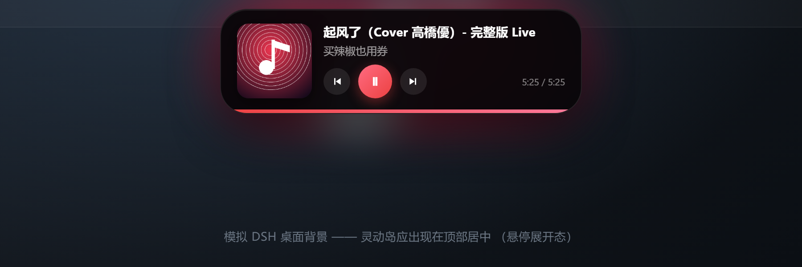

# dsh-netease-island

DSH 灵动岛（Dynamic Island）风格的网易云音乐挂件：在页面顶部居中显示一个胶囊，
展示当前播放的封面、歌名、歌手与进度，并提供播放/暂停、上一首、下一首、点击进度条跳转。



上面这张是在开发用的静态页里渲染真实 `lib/client.js` 的截图。下面这张是**真实 DSH 桌面窗口**里
运行时的现场截图（已裁到顶部条，只看挂件本身）：


## 它是怎么拿到播放状态的

**不调用任何网易云私有接口，不登录，不读 cookie，不访问账号数据。**

数据来自 Windows 的 **SMTC**（System Media Transport Controls，系统媒体控件）——
也就是你在按 `Win` 键时弹出的那个媒体控制浮层。任何向系统注册了媒体会话的播放器
（网易云、Spotify、浏览器里的网页播放器等）都会通过它对外暴露：

- 标题 / 歌手 / 专辑 / 封面缩略图
- 播放状态、播放进度与总时长
- 播放、暂停、上一首、下一首、跳转进度这些控制能力

宿主插件启动一个常驻的 Windows PowerShell 5.1 子进程（`lib/smtc-bridge.ps1`），
它从 SMTC 读取状态并按行输出 JSON，同时从 stdin 接收控制命令。
这样插件本身零依赖、不联网，也不需要用户做任何配置。

## 安装

从 GitHub 安装（推荐）：

```powershell
dsh plugin --profile desktop add github:yezisorft/dsh-netease-island
```

也可以直接用本目录的绝对路径安装：

```powershell
dsh plugin --profile desktop add <本目录的绝对路径>
```

然后**重启 DeepSeek Harness**。

> 重启这一步是必须的：客户端注入表在宿主启动时只采集一次，之后没有刷新入口。
> HTTP 路由是动态注册的，但页面里那份加载 `widget.js` 的注入行要在启动时才会被收集。

卸载：

```powershell
dsh plugin --profile desktop remove dsh-netease-island
```

## 使用

- 平时收起为顶部居中的小胶囊；鼠标移上去展开。
- 点击胶囊主体 = 播放 / 暂停。
- 展开后：左侧上一首，右侧下一首，中间进度条可点击跳转。
- 胶囊可以拖动，位置会被记住；双击（或拖到顶部）恢复默认位置。
- 没有正在播放的会话时，整个挂件自动隐藏，不占用屏幕。

## 环境要求

| 项目 | 要求 |
| --- | --- |
| 系统 | Windows 10 / 11（依赖 WinRT 的 `Windows.Media.Control`） |
| PowerShell | Windows PowerShell 5.1（`powershell.exe`，**不能**用 PowerShell 7 / pwsh） |
| 播放器 | 任何向 SMTC 注册媒体会话的播放器 |
| 网易云音乐 | 需要**正在播放**才会注册媒体会话（见下方“已知边界”） |

## 配置

在 profile 的 `cordis.patch.yml` 里给该条目加 `config`（不写就用下面的默认值）：

```yaml
- id: dsh-netease-island
  name: dsh-netease-island
  config:
    pollMs: 500          # 轮询间隔（毫秒），会被限制在 200 ~ 5000
    appPatterns:         # appId 子串匹配（忽略大小写），留空/无法解析则用默认值
      - cloudmusic
      - netease
      - com.netease
```

`appPatterns` 也可以写成逗号分隔的字符串：`appPatterns: 'cloudmusic,netease'`。
两项的**实际生效值**都会出现在 `/dsh-netease/state.json` 里，方便确认配置有没有吃进去。
`pollMs` 同时决定桥接进程的 `-PollMs` 和挂件自己的轮询节奏（挂件从 `state.json` 里读它）。

> `appPatterns` 里的**非 ASCII 字符会被丢弃**：这些片段是当命令行参数传给
> `powershell.exe` 的，控制台代码页会在桥接进程看到它之前就把中文参数弄坏
> （开发中实测到过 `网易云` 被解成 `缃戞槗浜?`）。网易云自己的 appId 是 ASCII，所以这不影响使用。

没有正在播放的会话时挂件会自动隐藏，不需要配置项。

命令行参数（`lib/smtc-bridge.ps1`，一般不用手动调）：

```
-PollMs <int>              轮询间隔，默认 500
-AppPattern '<a,b,c>'      逗号分隔的 appId 匹配片段
-Once                      只输出一次状态然后退出（调试用）
-LibraryOnly               只定义函数、不进入主循环（给 dev/test-cover.ps1 用）
```

## 故障排查

挂件不出现时，按顺序确认：

1. **DSH 是否重启过** —— 没重启就不会加载注入行。
2. **`http://127.0.0.1:19387/dsh-netease/state.json` 返回什么** —— 里面 `bridge` 字段会告诉你桥接进程的状态：
   - `down` + `detail` 会带出真实原因（例如 `spawn EPERM`）。
   - `up` 但没有 `active` —— 说明系统里没有媒体会话，去放一首歌。
3. **`notes` 字段** —— 桥接进程把每一次被吞掉的 WinRT 异常都记在这里。
   如果网易云暴露 SMTC 的方式和预期不同，原因会直接写在这。
4. **`sessionCount` 一直是 0，可音乐确实在放** —— 说明这个播放器根本没注册 SMTC 会话。
   网易云桌面版就是这种情况，见下面的“方案 B”。

## 已知边界（诚实说明）

这些是实测出来的结论，不是猜测：

- **已在重启后的真实 DSH desktop 壳里亲眼确认。** 修掉 `root.config` 未注入导致的崩溃后重启，
  真实窗口顶部居中出现胶囊，显示网易云当前曲目与“播放中”状态（现场截图：
  `dev/shots/island-live-dsh.png`）；`state.json` / `widget.js` / `cover.png` 三条路由全 200，
  控制回路实测 `toggle → Paused → toggle → Playing`，负向用例 405 / 403 / 400 全对。
- **未打补丁的网易云根本不注册 SMTC 会话。** 实测：正在播放时 `GetSessions()` 仍是
  `count=0`（150 秒内 75 次采样全部为 0），独立枚举与桥接进程 `-Once` 结论一致。
  它的 `winrt_utils.dll` 里确实带着 `SystemMediaTransportControls` 符号，但客户端不注册。
  所以**必须**走下面的方案 B，否则挂件永远不会亮。
  匹配片段为 `cloudmusic` / `netease` / `com.netease`；匹配不到时回退到“任意正在播放的会话”
  （用浏览器播放网页版也能点亮）。要调就改 `appPatterns`。
- **部分播放器不上报会移动的进度。** Edge 的 MediaSession 会话会接受跳转请求并返回成功，
  但位置读数始终是静态的；网易云接上 InfLink-rs 后进度正常（实测 `19.02 → 21.03 → 23.08`）。
- **`play` / `pause` 有回退逻辑。** 某些播放器（含 Edge）会“返回成功但状态不变”，
  因此桥接进程在显式调用后会回读状态，没变就改用 toggle。挂件自己发的是 `toggle`。
- **两个无害的噪音字段。** 网易云会话在个别 WinRT 调用上会抛异常、且不上报 `PlaybackRate`，
  于是 `state.json` 里会出现
  `notes: ["media properties failed: …", "this media session exposes no artwork thumbnail"]`
  和 `rate: 0`。元数据、封面（`cover.png` 实测 200，jpeg 75 KB）与进度都正常；
  客户端把 `rate: 0` 当 1 处理，不影响动画。

## 网易云桌面版不注册 SMTC？方案 B（本机已实测可行）

Win32 版网易云不发布 SMTC 会话，社区通行做法是用 **BetterNCM**（客户端插件加载器）
+ **InfLink-rs**（把播放状态发布到 SMTC）把这段补上：

| 组件 | 版本 | 校验 |
| --- | --- | --- |
| BetterNCM Installer | 1.2.0 | `betterncm_installer.exe` 673280 B |
| InfLink-rs | v3.3.0 | `InfLink-rs.plugin` 1611600 B，sha256 与官方公布摘要一致 |

步骤：

1. 下载 BetterNCM Installer（本机直连 GitHub 不通，可用 `https://gh-proxy.com/` 前缀拼在
   GitHub 地址前面，与插件市场用的是同一个镜像）；
2. 运行安装器完成向导，它会往客户端目录写入注入加载器 `msimg32.dll`（本机实测 1208320 B）；
3. 把 `InfLink-rs.plugin` 放进 `C:\betterncm\plugins\`（也可以从 BetterNCM 自带插件商店安装）；
4. 重启网易云音乐，开始播放 —— `state.json` 里的 `matched` 会从 `false` 变 `true`，
   歌名/歌手/专辑/封面/进度与控制能力全部就位。

风险与回退：这是第三方注入，网易云官方不支持；杀软可能误报；客户端升级后可能失效。
回退方式：用 BetterNCM 安装器卸载，或手动删掉 `C:\betterncm` 与客户端目录里的 `msimg32.dll`。

## 开发自测

`dev/` 不随包安装（`package.json` 的 `files` 白名单只放 `lib/`、`cordis.patch.yml`、文档），
但仓库里保留着全部自测脚本。它们需要一个不受限的 shell（要能给子进程接管道、要能起 headless 浏览器）：

```powershell
# 宿主插件半边：路由、注入行、信任边界、生命周期（45 项；有真实封面时 47 项）
node dev/test-host.mjs

# 配置项契约：默认值 / 生效值 / 钳制 / 容错（12 项）
node dev/test-config.mjs

# 封面提取：真实 WinRT 流 + 字节级比对（11 项）
powershell -File dev/test-cover.ps1

# 桥接进程半边：行协议 + 真实 SMTC 读/控（30 项）+ UI 截图与几何断言
powershell -File dev/recheck.ps1

# 只跑 UI 那一半（不起桥接进程）
powershell -File dev/recheck.ps1 -SkipBridge
```

`dev/test-bridge.mjs` 会用 Edge 打开 `dev/smtc-test.html` 造一个**真实**的 SMTC 会话
（一段 1 LSB 抖动噪声，几乎无声），因此桥接的读取与控制是端到端验证过的。

`dev/recheck.ps1` 还会用 headless Edge 打开 `dev/harness.html`（用 mock 状态喂**真实的**
`lib/client.js`），对**稳定后**的几何做断言：胶囊尺寸、是否在视口内、是否不透明、
**是否水平居中**，截图写到 `dev/shots/`。断言只依赖 `?debug=1` 输出的 JSON 与 `--dump-dom`，
不靠人眼看图。

### 自测修掉的真实 bug

都不是测试环境的问题，是挂件本身的问题：

1. **展开态整块透明。** 胶囊元素自己带着 `expanded` 状态类，于是裸的 `.expanded`
   布局规则也命中了胶囊自身，把 `opacity:0 / position:absolute` 套了上去。
   真实浏览器里过渡跑完，展开态会**完全看不见**。改成 `.island .expanded` 限定为后代。
2. **展开后不居中。** host 没有确定宽度，`left:50% + translateX(-50%)` 里的 -50%
   解析不到胶囊宽度，展开后整体偏右 202px（实测 `centreDelta=+202`，修好后为 0）。
   给 host 显式宽度并同步 `:host(.expanded)`。
3. **CSS 模板字符串里的反引号。** 在 CSS 注释里写反引号会提前终止 JS 模板字符串，
   整个挂件静默不加载（截图与"完全没渲染"那一次逐字节相同）。踩了两次，
   现在每次改完都先 `node --check lib/client.js`。
4. **封面永远是空的。** `IAsyncOperation<IRandomAccessStreamWithContentType>` 被当成
   普通 Task 取 `.Result` 时，PowerShell 5.1 给回的是 `System.__ComObject`，
   属性全都读不到，`[int]$stream.Size` 静默变成 0。而端到端测试又把它当成
   "这个会话没有缩略图"**跳过了**，于是 bug 一直被绿测掩盖。改成反射调用
   `RandomAccessStream.CopyAsync` 拷贝到 `InMemoryRandomAccessStream` 后，
  真实 Edge 会话的封面能完整取出（字节级比对一致）。
5. **进度条永远不动。** 时间轴读的是 `$playback.GetTimelineProperties()`，
   而这个方法在 `$session` 上，异常被 `catch {}` 吞掉，position/duration 一直是 0。
   现在所有吞掉的异常都会写进 `notes` 字段暴露出来。

## 许可

代码按 [MIT](LICENSE) 发布。素材与第三方组件的情况见 [PROVENANCE.md](PROVENANCE.md)。
